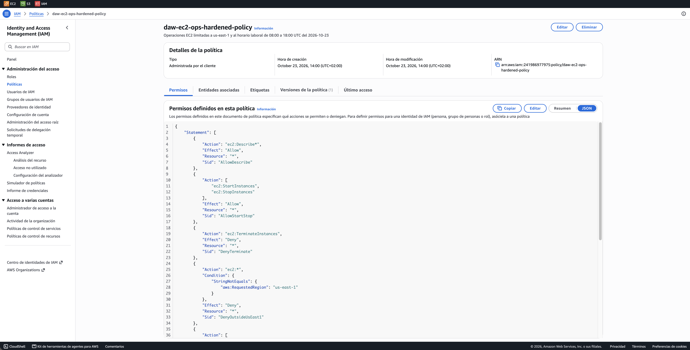

# Hardening con condiciones

**Enunciado:** Ampliación parte 3

## Escenario

Aplicar el principio de mínimo privilegio no solo según quién hace una acción, sino también dónde y cuándo. Se parte de la política de [Operaciones EC2](ec2-ops.md) y se le añaden condiciones

## Requisitos

- **Restricción geográfica:** solo se pueden operar servidores en `us-east-1`
- **Restricción horaria:** encender y apagar solo está permitido de 08:00 a 18:00 UTC
- Nombre de la política: `daw-ec2-ops-hardened-policy`

## Versión o política nueva

El enunciado propone modificar la política o crear una nueva versión. En AWS Academy `iam:CreatePolicyVersion` está denegado, así que la política endurecida se crea como una política independiente y `daw-ec2-ops-policy` se mantiene sin cambios

!!! note "Nombre de la política"
    El enunciado menciona `asix-ec2-ops-policy`, mientras que la parte 2 usa el prefijo `daw-`. En este proyecto se mantiene el prefijo `daw-`

## Política

Mantiene las tres sentencias de la política de operaciones y añade tres denegaciones con condición. La ventana horaria se genera igual que en [Acceso por horario](horario.md)

```json
--8<-- "policies/ec2-ops-hardened.json.tftpl"
```

| Sentencia | Efecto | Para qué |
|---|---|---|
| `AllowDescribe` | Allow | Ver los recursos de EC2 |
| `AllowStartStop` | Allow | Arrancar y parar instancias |
| `DenyTerminate` | Deny | Bloquea la terminación |
| `DenyOutsideUsEast1` | Deny | Bloquea cualquier acción de EC2 fuera de `us-east-1` |
| `DenyStartStopBeforeOpening` | Deny | Bloquea arrancar y parar antes de la apertura |
| `DenyStartStopAfterClosing` | Deny | Bloquea arrancar y parar después del cierre |

## Terraform

```hcl
--8<-- "envs/academy/main.tf:37:44"
```

## Comprobaciones esperadas

| Acción | Región | Hora | Resultado esperado |
|---|---|---|---|
| `ec2:StartInstances` | `us-east-1` | 10:00 | Allowed |
| `ec2:StartInstances` | `eu-west-1` | 10:00 | Denied |
| `ec2:StartInstances` | `us-east-1` | 20:00 | Denied |

!!! note "Denied (condition failed) frente a explicit deny"
    El enunciado espera en el test 4B un *Denied (condition failed)*, que es lo que se obtiene con un `Allow` limitado por una condición: la condición no se cumple y la acción queda sin permiso. Con el `Deny` explícito de este proyecto el simulador indica una denegación explícita. El resultado es el mismo, la acción queda denegada, pero la restricción se mantiene aunque otra política conceda el permiso

## Verificación automática

| Test | Contexto | Resultado |
|---|---|---|
| `test_4a_hardened_start_us_east_1_allowed` | `us-east-1`, 10:00 | `allowed` |
| `test_4b_hardened_start_eu_west_1_denied` | `eu-west-1`, 10:00 | `explicitDeny` |
| `hardened_start_after_closing_denied` | `us-east-1`, 20:00 | `explicitDeny` |
| `hardened_terminate_denied` | `us-east-1`, 10:00 | `explicitDeny` |

## Política desplegada en AWS



## Simulador de políticas

La región y la hora se indican en *Condiciones de solicitud globales* con las claves `aws:RequestedRegion` y `aws:CurrentTime`

Test 4A: en `us-east-1` a las 10:00, `StartInstances` sale **Permitido**

!!! info "Verificado con Terraform"
    El simulador web nuevo no aplica las condiciones globales (`aws:RequestedRegion`, `aws:CurrentTime`), así que este caso se comprueba con el test `test_4a_hardened_start_us_east_1_allowed` de [Pruebas con el simulador](../auditoria/simulador.md)

Test 4B: en `eu-west-1` a las 10:00, sale **Denegado** por la sentencia `DenyOutsideUsEast1`

!!! info "Verificado con Terraform"
    El simulador web nuevo no aplica las condiciones globales (`aws:RequestedRegion`, `aws:CurrentTime`), así que este caso se comprueba con el test `test_4b_hardened_start_eu_west_1_denied` de [Pruebas con el simulador](../auditoria/simulador.md)
