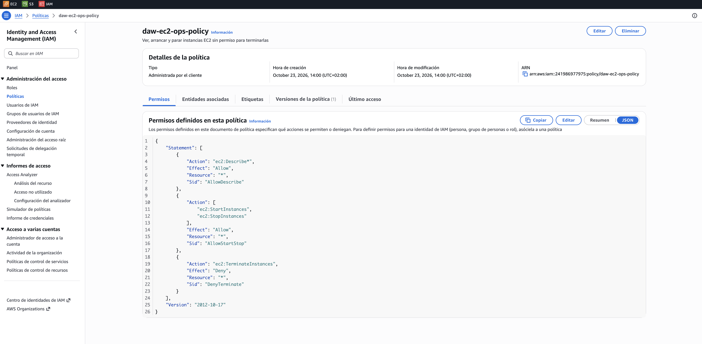
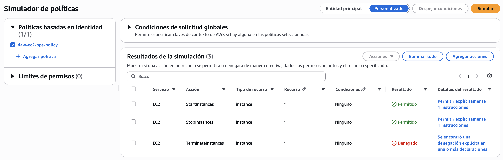

# Operaciones EC2

**Enunciados:** Ejercicios IAM 4 · Ampliación partes 0 y 2

## Escenario

El equipo de soporte necesita encender los servidores por la mañana y apagarlos por la noche. La semana pasada un empleado eliminó por error un servidor web crucial, así que no deben poder terminar instancias

## Requisitos

- Permitir ver (`Describe*`) todos los recursos de EC2
- Permitir arrancar (`StartInstances`) y parar (`StopInstances`) cualquier instancia
- Denegar explícitamente la terminación (`TerminateInstances`)
- Nombre de la política: `daw-ec2-ops-policy`

## Política

```json
--8<-- "policies/ec2-ops.json"
```

| Sentencia | Efecto | Para qué |
|---|---|---|
| `AllowDescribe` | Allow | `ec2:Describe*` permite ver instancias, volúmenes, grupos de seguridad y el resto de recursos de EC2 |
| `AllowStartStop` | Allow | Arrancar y parar instancias |
| `DenyTerminate` | Deny | Bloquea la terminación aunque otra política la permita |

!!! note "Parar no es terminar"
    Parar una instancia la apaga y conserva su disco, de modo que se puede volver a arrancar. Terminarla la elimina de forma definitiva junto con su volumen raíz, que es lo que provocó el incidente del escenario

## Terraform

```hcl
--8<-- "envs/academy/main.tf:10:17"
```

## Comprobaciones esperadas

| Acción | Resultado esperado |
|---|---|
| `ec2:StartInstances` | Allowed |
| `ec2:StopInstances` | Allowed |
| `ec2:TerminateInstances` | Denied (explicit deny) |

## Verificación automática

| Test | Acciones | Resultado |
|---|---|---|
| `test_3_ec2_terminate_denied` | `TerminateInstances` | `explicitDeny` |
| `ec2_ops_start_stop_describe_allowed` | `StartInstances`, `StopInstances`, `DescribeInstances` | `allowed` |

## Política desplegada en AWS



## Simulador de políticas

`StartInstances` y `StopInstances` salen **Permitido** y `TerminateInstances` **Denegado** por la sentencia `DenyTerminate`


