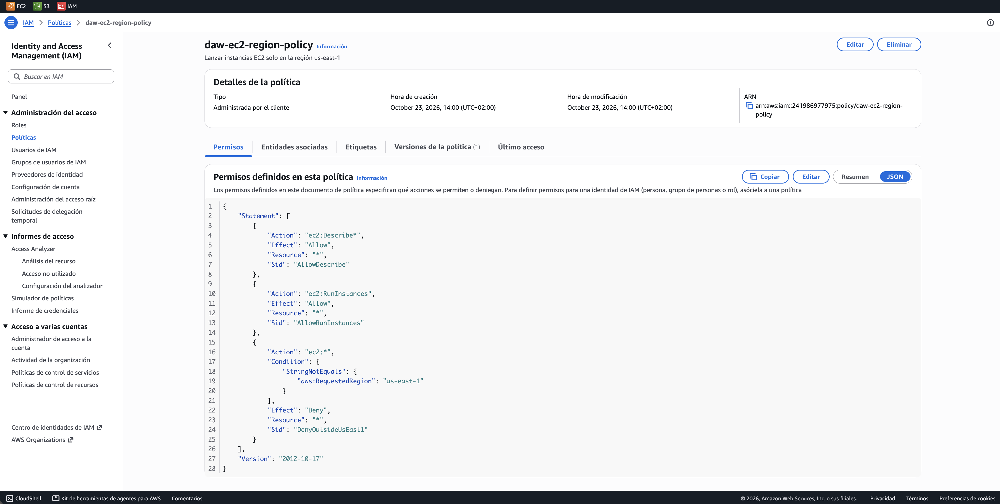
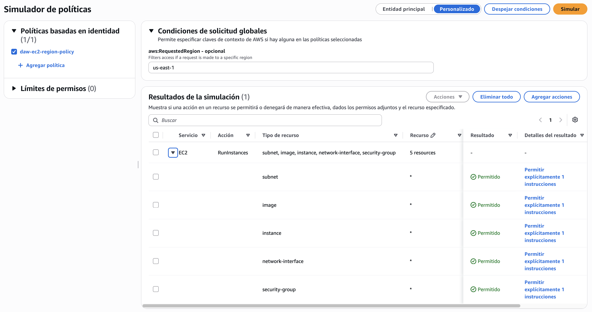

# EC2 restringido a región

**Enunciado:** Ejercicios IAM 2

## Objetivo

Permitir que un usuario solo cree instancias EC2 en la región `us-east-1` (Norte de Virginia)

## Requisitos

- Lanzar instancias (`RunInstances`) solo en `us-east-1`
- Cualquier intento en otra región debe ser denegado
- Nombre de la política: `daw-ec2-region-policy`

## Política

```json
--8<-- "policies/ec2-region.json"
```

| Sentencia | Efecto | Para qué |
|---|---|---|
| `AllowDescribe` | Allow | Ver los recursos de EC2, necesario para usar el asistente de lanzamiento de la consola |
| `AllowRunInstances` | Allow | Lanzar instancias |
| `DenyOutsideUsEast1` | Deny | Bloquea cualquier acción de EC2 cuando la región solicitada no es `us-east-1` |

### La clave `aws:RequestedRegion`

Cada petición a AWS lleva la región a la que va dirigida, y IAM la expone en la clave de condición `aws:RequestedRegion`. La condición `StringNotEquals` hace que el `Deny` se aplique a todas las regiones salvo `us-east-1`

!!! note "¿Por qué Deny y no un Allow con condición?"
    Un `Allow` limitado a `us-east-1` también funcionaría con esta política sola. Con el `Deny` explícito la restricción se mantiene aunque el usuario reciba permisos de EC2 en otras regiones por otra política

## Terraform

```hcl
--8<-- "envs/academy/main.tf:19:26"
```

## Comprobaciones esperadas

| Acción | Región | Resultado esperado |
|---|---|---|
| `ec2:RunInstances` | `us-east-1` | Allowed |
| `ec2:RunInstances` | `eu-west-1` | Denied |

!!! note "Verificación"
    El enunciado propone adjuntar la política a un usuario de prueba y lanzar una instancia en otra región. Como AWS Academy no permite crear usuarios, la restricción se verifica con el simulador indicando la región en el contexto de la petición

## Verificación automática

| Test | Región | Resultado |
|---|---|---|
| `ec2_region_run_instances_us_east_1_allowed` | `us-east-1` | `allowed` |
| `ec2_region_run_instances_eu_west_1_denied` | `eu-west-1` | `explicitDeny` |

## Política desplegada en AWS



## Simulador de políticas

La región se indica en *Condiciones de solicitud globales* con la clave `aws:RequestedRegion`

Con `us-east-1`, `RunInstances` sale **Permitido**



Con `eu-west-1`, sale **Denegado** por la sentencia `DenyOutsideUsEast1`

!!! info "Verificado con Terraform"
    El simulador web nuevo no aplica las condiciones globales (`aws:RequestedRegion`, `aws:CurrentTime`), así que este caso se comprueba con el test `ec2_region_run_instances_eu_west_1_denied` de [Pruebas con el simulador](../auditoria/simulador.md)
