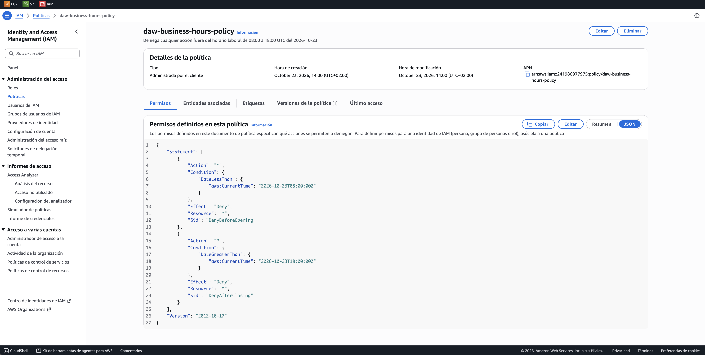

# Acceso por horario

**Enunciado:** Ejercicios IAM 3

## Objetivo

Permitir que un usuario acceda a AWS solo en horario laboral, de 08:00 a 18:00 UTC

## Requisitos

- Denegar cualquier acción antes de las 08:00 y después de las 18:00 UTC
- Nombre de la política: `daw-business-hours-policy`

## Limitación de IAM

IAM no tiene una condición de horario que se repita cada día. La clave de condición `aws:CurrentTime` solo admite comparaciones con fechas completas (`DateGreaterThan`, `DateLessThan`), por ejemplo `2026-10-23T08:00:00Z`

Por eso una política estática solo puede limitar el acceso a una ventana concreta, no a "todos los días de 8 a 18". Es una limitación del propio IAM, no de AWS Academy

Además, IAM no impide iniciar sesión en la consola: lo que hace la política es denegar todas las acciones fuera del horario, de modo que la consola queda inutilizable

## Solución adoptada

La política se escribe como **plantilla** y Terraform genera la ventana de un día concreto, indicado en la variable `business_day`

```hcl
--8<-- "envs/academy/terraform.tfvars"
```

```hcl
--8<-- "envs/academy/locals.tf"
```

Para aplicar el horario a otro día basta con cambiar la fecha y hacer `terraform apply`: el módulo detecta que el JSON ha cambiado y reemplaza la política

## Política

```json
--8<-- "policies/business-hours.json.tftpl"
```

| Sentencia | Efecto | Para qué |
|---|---|---|
| `DenyBeforeOpening` | Deny | Bloquea todo antes de la hora de apertura |
| `DenyAfterClosing` | Deny | Bloquea todo después de la hora de cierre |

!!! note "Una política que solo deniega"
    La política no concede ningún permiso: es una barrera que se adjunta junto a las políticas que sí los dan, como las de los grupos. Dentro del horario no interfiere y fuera de él su `Deny` explícito prevalece sobre cualquier `Allow`

    Se usan dos sentencias porque las condiciones de una misma sentencia se combinan con Y, y aquí se necesita un O: antes de abrir **o** después de cerrar

## Terraform

```hcl
--8<-- "envs/academy/main.tf:28:35"
```

## Comprobaciones esperadas

| Momento | Resultado esperado |
|---|---|
| Dentro de la ventana | Allowed |
| Fuera de la ventana | Denied |

## Verificación automática

La política se simula junto a `daw-s3-readonly-policy`, que aporta el permiso de lectura, indicando la hora en el contexto de la petición

| Test | Hora | Resultado |
|---|---|---|
| `business_hours_inside_window_allowed` | 10:00 | `allowed` |
| `business_hours_before_opening_denied` | 07:00 | `explicitDeny` |
| `business_hours_after_closing_denied` | 20:00 | `explicitDeny` |

## Política desplegada en AWS

La descripción indica el día y las horas de la ventana, y el JSON muestra las fechas generadas por Terraform



## Simulador de políticas

Se simulan juntas `daw-s3-readonly-policy` y `daw-business-hours-policy`, indicando la hora en *Condiciones de solicitud globales* con la clave `aws:CurrentTime`

A las 10:00, dentro del horario, `GetObject` sale **Permitido**

!!! info "Verificado con Terraform"
    El simulador web nuevo no aplica las condiciones globales (`aws:RequestedRegion`, `aws:CurrentTime`), así que este caso se comprueba con el test `business_hours_inside_window_allowed` de [Pruebas con el simulador](../auditoria/simulador.md)

A las 20:00, fuera del horario, sale **Denegado** por la sentencia `DenyAfterClosing`

!!! info "Verificado con Terraform"
    El simulador web nuevo no aplica las condiciones globales (`aws:RequestedRegion`, `aws:CurrentTime`), así que este caso se comprueba con el test `business_hours_after_closing_denied` de [Pruebas con el simulador](../auditoria/simulador.md)
