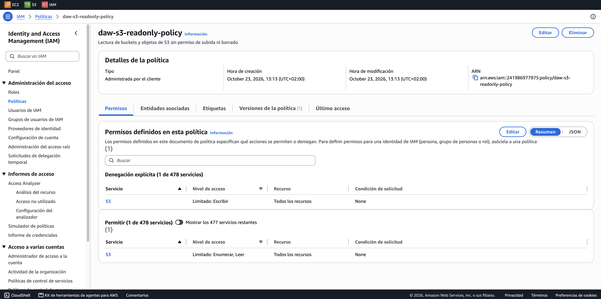
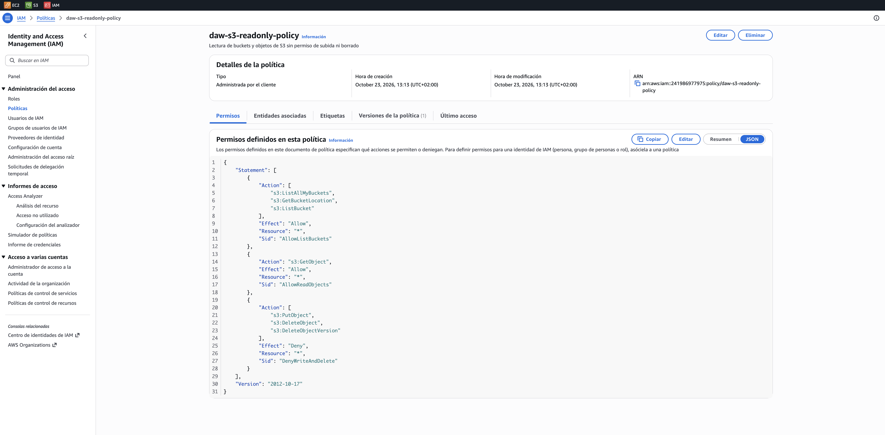
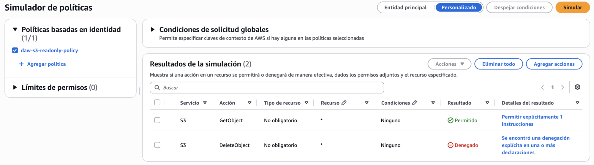

# S3 de solo lectura

**Enunciados:** Ejercicios IAM 1 · Ampliación parte 1

## Escenario

El departamento de analítica necesita consultar los backups guardados en Amazon S3, pero el equipo de seguridad prohíbe que puedan borrar o modificar los datos existentes

## Requisitos

- Permitir listar todos los buckets (`ListBucket`)
- Permitir descargar y leer objetos (`GetObject`)
- No permitir bajo ningún concepto la subida (`PutObject`) ni el borrado (`DeleteObject`)
- Nombre de la política: `daw-s3-readonly-policy`

## Política

```json
--8<-- "policies/s3-readonly.json"
```

| Sentencia | Efecto | Para qué |
|---|---|---|
| `AllowListBuckets` | Allow | `ListAllMyBuckets` muestra los buckets de la cuenta, `ListBucket` lista los objetos de cada bucket y `GetBucketLocation` lo necesita la consola para abrirlos |
| `AllowReadObjects` | Allow | `GetObject` permite descargar y leer los objetos |
| `DenyWriteAndDelete` | Deny | Bloquea subir, sobrescribir y borrar objetos, también sus versiones anteriores |

!!! note "¿Por qué un Deny si ya no hay Allow?"
    Sin el bloque `Deny`, la subida y el borrado ya estarían denegados de forma implícita. El enunciado pide que no se permitan *bajo ningún concepto*: con un `Deny` explícito la restricción se mantiene aunque el usuario reciba permisos de escritura por otra política o grupo

## Terraform

La política se despliega con el módulo `iam-policy` desde el entorno de AWS Academy

```hcl
--8<-- "envs/academy/main.tf"
```

## Política desplegada en AWS

La consola de IAM resume los permisos por servicio: S3 aparece una vez con **denegación explícita** de escritura y otra con **permiso** de enumerar y leer



El JSON que muestra la consola coincide con el de `policies/s3-readonly.json`



## Comprobaciones esperadas

| Acción | Resultado esperado |
|---|---|
| `s3:GetObject` | Allowed |
| `s3:DeleteObject` | Denied |

## Simulador de políticas

En el simulador de IAM, modo *Personalizado*, con la política pegada como política basada en identidad. `GetObject` sale **Permitido** y `DeleteObject` **Denegado** por una denegación explícita, la sentencia `DenyWriteAndDelete`



## Verificación automática

Los tests 1 y 2 de la auditoría se ejecutan con `terraform test` contra el simulador de IAM, sin crear nada en la cuenta. Además se comprueban el listado de buckets y el bloqueo de la subida

```text
$ terraform test
tests/simulation.tftest.hcl... in progress
  run "test_1_s3_get_object_allowed"... pass
  run "test_2_s3_delete_object_denied"... pass
  run "s3_list_allowed"... pass
  run "s3_write_denied"... pass
tests/simulation.tftest.hcl... pass

Success! 4 passed, 0 failed.
```

El test 2 exige `explicitDeny` y no solo una denegación. Si se eliminara la sentencia `DenyWriteAndDelete`, el simulador devolvería `implicitDeny` y el test fallaría, porque la política dejaría de cumplir el *bajo ningún concepto* del enunciado
